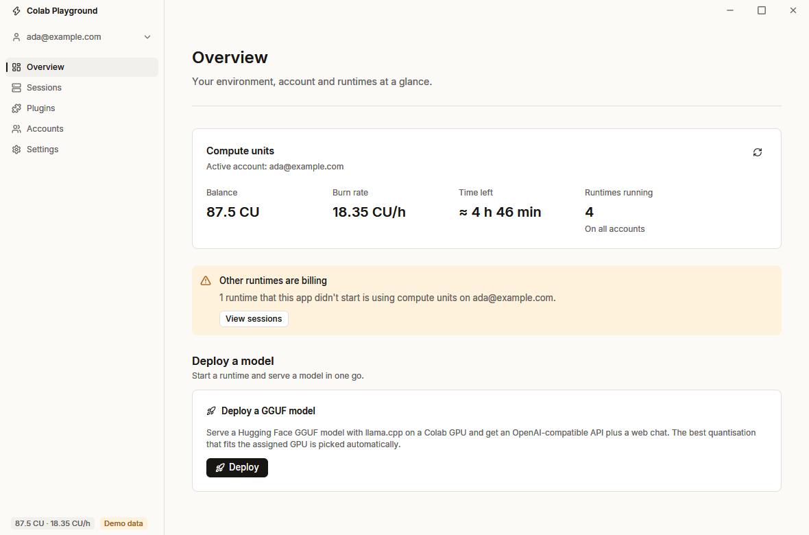
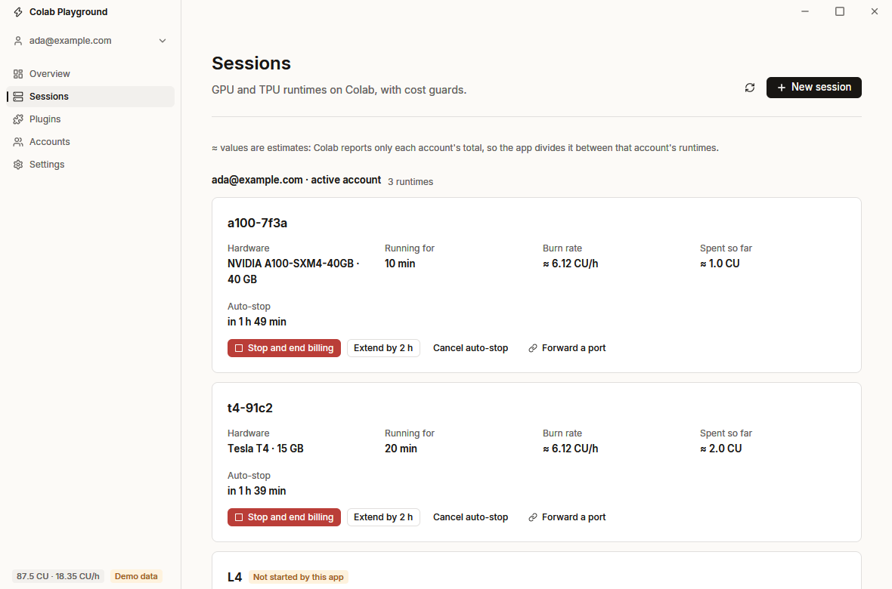
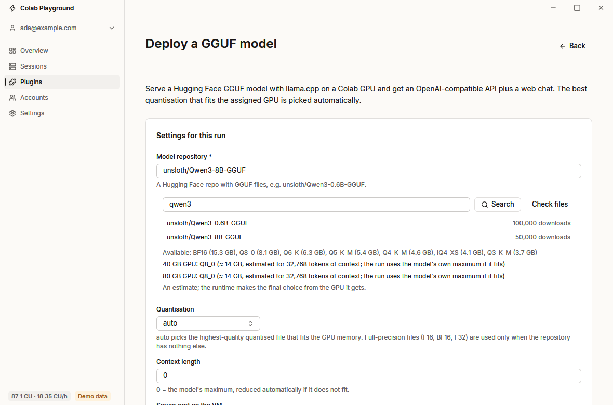

# Colab Playground

A desktop app for the Google Colab CLI. It keeps several Google accounts, starts and stops Colab runtimes under cost limits, forwards ports from a runtime to your computer, and runs plugins on the runtime. Everything goes through the colab CLI; it is not a notebook editor. Built in Rust on GPUI and Ely GPUI Components.

## What it does

- **Guided setup.** A checklist finds the Colab CLI or installs it, then signs you in.
- **Several Google accounts.** Save them, switch between them, and see each account's balance without switching. Before a switch, the app lists what it affects.
- **Sessions on the hardware you pick.** CPU, a GPU or a TPU, high RAM and a minimum GPU memory. When Colab hands out a smaller GPU than the minimum, the app gives it back and tries again. Runtimes opened in the browser are listed too, and can be stopped.
- **Cost guards.** Auto-stop and idle stop run on the runtime itself, so they hold with the app closed. A spending cap and a balance floor apply while the app runs. Balance, burn rate and time left update live.
- **Port forwarding.** A runtime port reaches 127.0.0.1 on your computer.
- **Plugins.** A manifest and one script that runs on the Colab runtime, never on your computer. The bundled one serves a Hugging Face GGUF model with llama.cpp, with an OpenAI-compatible API and a web chat, and picks the best quantisation for the GPU it gets.
- **Languages and theme.** 简体中文, 繁體中文 and English; light, dark or the system's.

## Who it is for

People who rent Colab GPUs and want sessions, spend and models in one window, without leaving runtimes billing by accident.

Releases for Windows, macOS on Apple silicon and Linux, and the source: https://github.com/scarletkc/colab-playground
