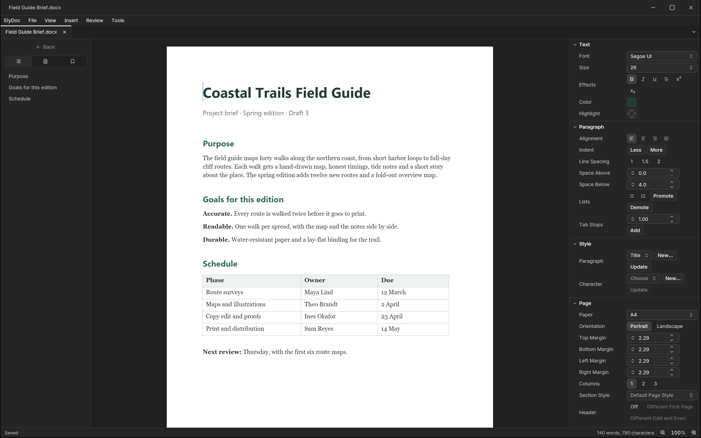

ElyDoc writes letters, reports and books, and opens and saves Word
files. It is the word processor of Ely Office, six desktop apps that
work with the network off: no account, no cloud service, and your
files stay in your folders.

DOCX and ODT open and save in their own format; DOC and RTF open too.
Underneath runs a patched LibreOffice engine, so styles, sections,
headers and footers, tables, images with anchors and wrapping, tables
of contents, footnotes, bookmarks, cross-references, comments and
tracked changes survive the round trip. Files with macros open in a
safe mode that never runs them and saves only a copy. When a document
asks for a font the computer lacks, a bar above the page names it.

On top sits an Ely interface. The left column holds the outline, the
pages and the bookmarks; the right column is an inspector for the
text, the paragraph, the style and the page, which changes as the
cursor moves. Unsaved work leaves a recovery point every ten seconds,
on this machine only, and comes back as a copy after a crash.

ElyDoc is open source under the MIT licence, for macOS, Windows and
Linux. More about Ely Office at [office.elygpui.com](https://office.elygpui.com/),
and the code on [GitHub](https://github.com/ELY-Open-Source/ElyOffice).

