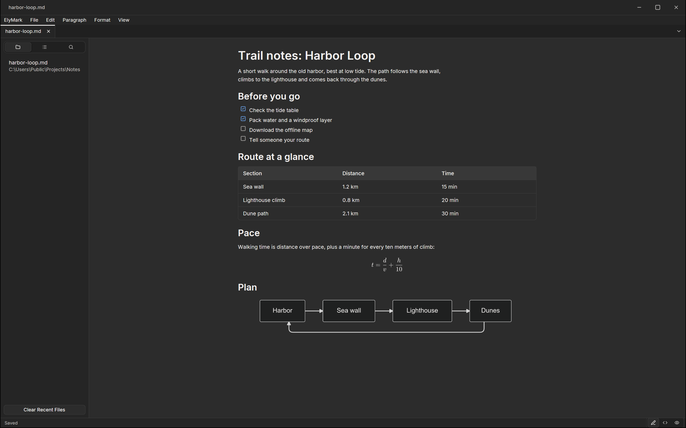

ElyMark is the Markdown editor of Ely Office, six desktop apps that work
with the network off: no account, no cloud service, and your files stay
in your folders. Markdown as you read it, with math and diagrams in
place.

You type into the rendered page. Headings, lists, task lists, tables,
quotes and links take their shape as you write, formulas are set by
RaTeX inline and in blocks, and Mermaid diagrams are drawn where their
block stands. One key switches to the source and back, and a preview
mode only reads. The menus and shortcuts follow Typora, so its users
feel at home.

The file stays plain Markdown. ElyMark keeps its line endings and writes
back only the characters you changed, and a file with a path saves by
itself a second after you stop typing. Nothing goes online: web images
are not loaded and HTML does not run. Notes export to HTML, PDF and
plain text, or copy out as Markdown, HTML or rich text.

ElyMark is open source under the MIT licence, for macOS, Windows and
Linux. More about Ely Office at [office.elygpui.com](https://office.elygpui.com/),
and the code on [GitHub](https://github.com/ELY-Open-Source/ElyOffice).

