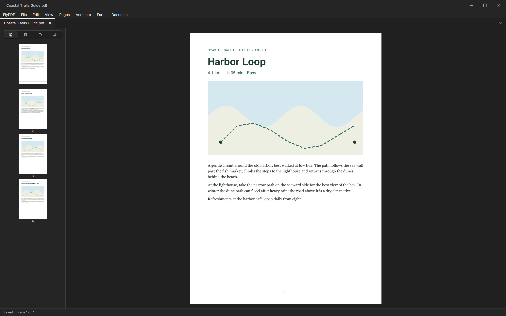

ElyPDF is the PDF app of Ely Office, six desktop apps that work with the
network off: no account, no cloud service, and your files stay in your
folders. Read, mark up, sign and fill forms, and find text in scans.

Underneath run a patched MuPDF and Tesseract. Pages can be added,
deleted, moved, rotated and cropped; text and images edited; highlights,
notes and drawings added; text, check, radio and choice fields filled;
bookmarks, links, attachments and properties changed. OCR lays a text
layer over a scan so it can be searched and copied. Content can be
redacted and the file cleaned, passwords and permissions set, and a
visible digital signature placed and written as an incremental update.
A signed or repaired file saves only as a copy, and a bar says why.

The Ely interface shows the pages in the middle and, on the left, page
thumbnails, bookmarks and attachments. Pages view one at a
time, two side by side or as one continuous strip, at fit width, fit
page or any zoom. Exports go to PDF, an optimized PDF, text, or PNG
pages at 72, 150 or 300 dpi.

ElyPDF is open source under the MIT licence, for macOS, Windows and
Linux. More about Ely Office at [office.elygpui.com](https://office.elygpui.com/),
and the code on [GitHub](https://github.com/ELY-Open-Source/ElyOffice).

