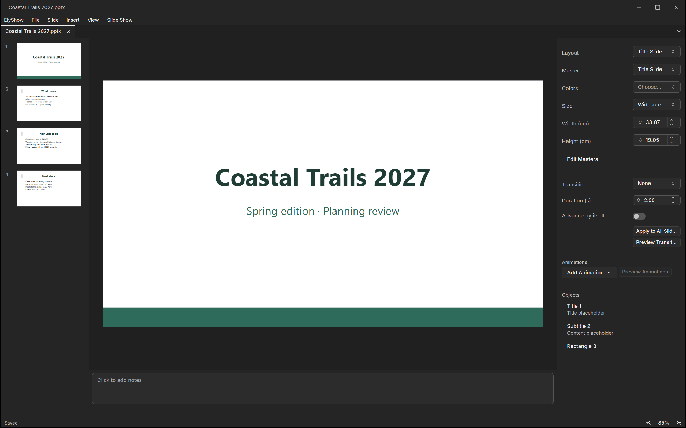

ElyShow is the presentation app of Ely Office, six desktop apps that
work with the network off: no account, no cloud service, and your files
stay in your folders. Slides, animation and a presenter view; it opens
PowerPoint files.

PPTX and ODP open and save in their own format, and PPT opens too.
Underneath runs a patched LibreOffice engine. Hidden slides stay hidden,
speaker notes stay with their slides, and effects a file brings beyond
ElyShow's own set are kept and shown by name.

The Ely interface puts the slide in the middle, the slide list on the
left and the notes below. The inspector on the right sets the layout,
the master, the colors and the slide size, picks a transition and its
duration, and adds animations to the objects listed under it, with a
preview before you present. Decks export to PDF as slides or as
handouts, and each slide to PNG.

ElyShow is open source under the MIT licence, for macOS, Windows and
Linux. More about Ely Office at [office.elygpui.com](https://office.elygpui.com/),
and the code on [GitHub](https://github.com/ELY-Open-Source/ElyOffice).

