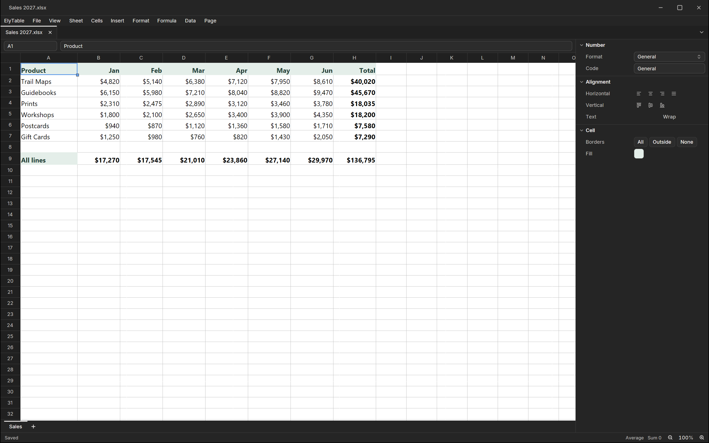

ElyTable is the spreadsheet of Ely Office, six desktop apps that work
with the network off: no account, no cloud service, and your files stay
in your folders. Formulas, filters, charts; it opens and saves Excel
files.

XLSX and ODS open and save in their own format, and XLS opens too. CSV,
TSV and plain text come in through an import dialog that sets the
encoding, the separator, the quotes and each column's type, and the
original file is left alone. Underneath runs a patched LibreOffice
engine with Excel's A1 formula syntax, so formulas are recalculated on
load and a function it does not know shows #NAME? while the formula
itself is kept.

The Ely interface keeps the grid in front. The name box and the formula
bar sit above it; typing a formula lists matching functions, and Tab or
Enter takes one and goes on to its arguments. The inspector on the right
sets the number format, the alignment, the borders and the fill, and the
status bar sums and averages the selection. Sheets export to PDF, and
the current one to CSV or TSV.

ElyTable is open source under the MIT licence, for macOS, Windows and
Linux. More about Ely Office at [office.elygpui.com](https://office.elygpui.com/),
and the code on [GitHub](https://github.com/ELY-Open-Source/ElyOffice).

