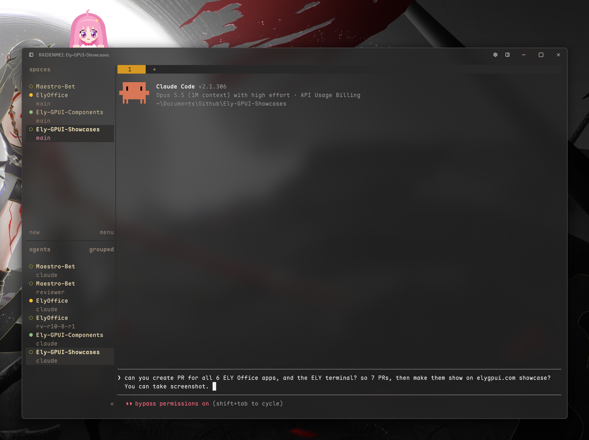

ELYTerminal is a terminal for macOS, Windows and Linux, written in Rust
on GPUI and Ely components. Sessions sit on the left, the terminal in
the middle, Git or Files on the right, and every setting has a control
in the settings window.

The terminal runs on alacritty_terminal: truecolor, five underline
styles, wide characters and combining marks, with box drawing and
powerline shapes drawn as geometry so lines join across cells. Keys
follow xterm and the kitty keyboard protocol, and on Windows
win32-input-mode, so tools such as herdr get every shortcut. Shell
integration for zsh, bash, fish and PowerShell marks each prompt,
command and exit status, and a jump key moves between prompts.

It is made for coding agents. A session's row shows what its programs
report, waiting on you, an error, work with its progress, or done, and a
session that needs you posts a notification while the window is in the
background. Ely, the mascot, peeks over the window's top edge: she hops
when a program waits on you, shakes at an error, cheers a finish, reads
along while work runs and dozes when all is calm.

Files shows the session's folder as a tree with Git's marks; Git stages,
commits and opens diffs. Fourteen themes, Catppuccin, Tokyo Night,
Dracula, Nord and more, a second theme for dark mode, and background
blur on every platform.

ELYTerminal is open source under the MIT licence, on
[GitHub](https://github.com/ELY-Open-Source/ELYTerminal).

