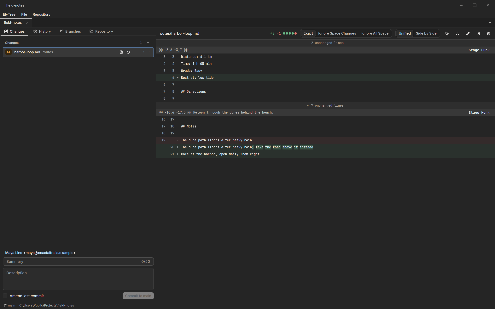

ElyTree is the Git client of Ely Office, six desktop apps that work with
the network off: no account, no cloud service, and your files stay in
your folders. Stage lines, commit, read the graph: Git without a
terminal.

It works on ordinary local repositories through the Git it ships with,
and everything it writes is a plain Git commit or reference. It goes
online only when you fetch, pull, push or clone, with the credentials
your Git setup already has.

The Changes page lists staged and unstaged files beside a unified or
side-by-side diff, with word-level highlights and whitespace modes;
stage a whole file, one hunk or single lines, then write the summary and
commit. History searches commits and follows a file or a line back
through blame. Branches switches, merges, rebases and tags.

Steps that can lose work say so first. Discarding changes or cleaning
untracked files lists what will go. A force push names the commits it
would overwrite and is refused if the remote moved since your last
fetch. The reflog brings deleted branches back, and moving a branch
keeps your working changes: ElyTree never hard-resets.

ElyTree is open source under the MIT licence, for macOS, Windows and
Linux. More about Ely Office at [office.elygpui.com](https://office.elygpui.com/),
and the code on [GitHub](https://github.com/ELY-Open-Source/ElyOffice).

