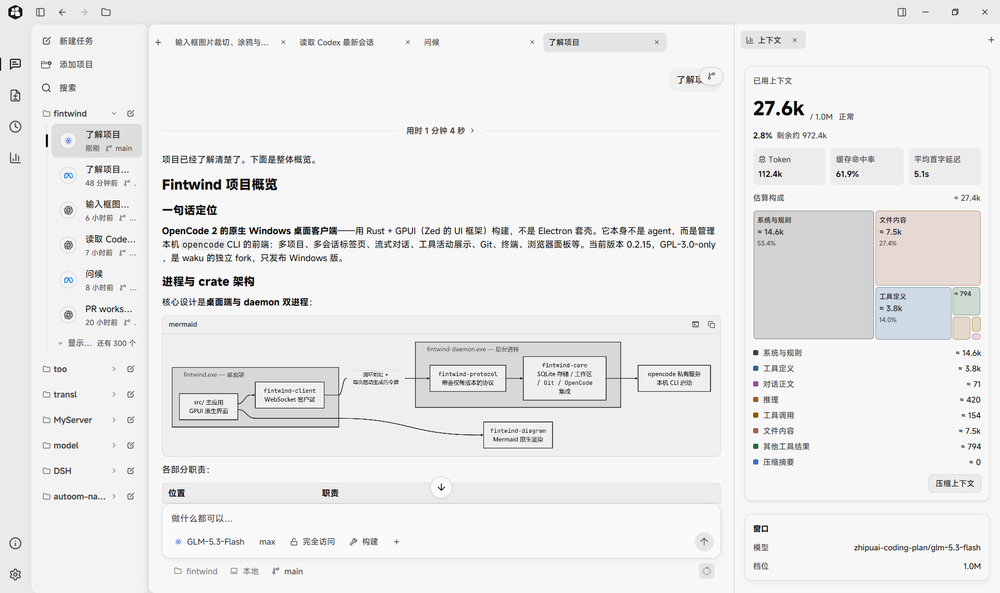
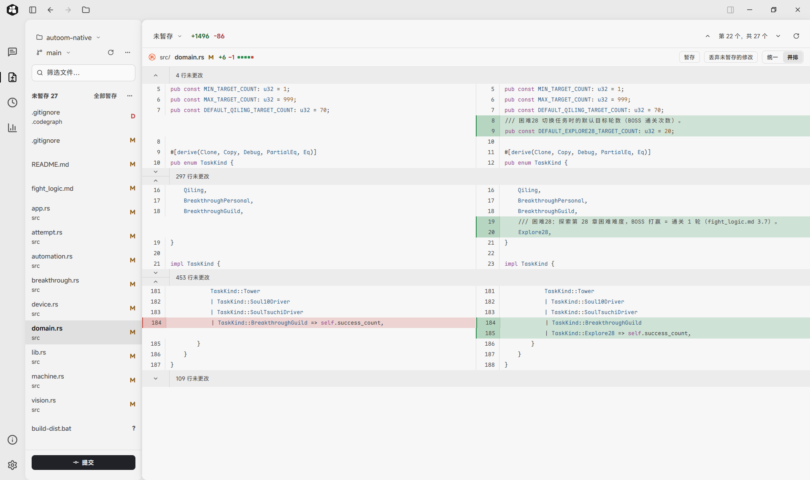
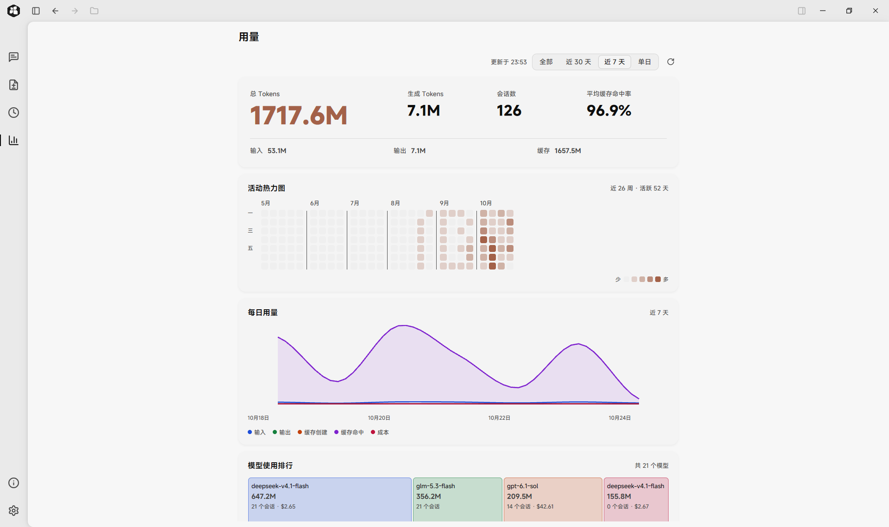
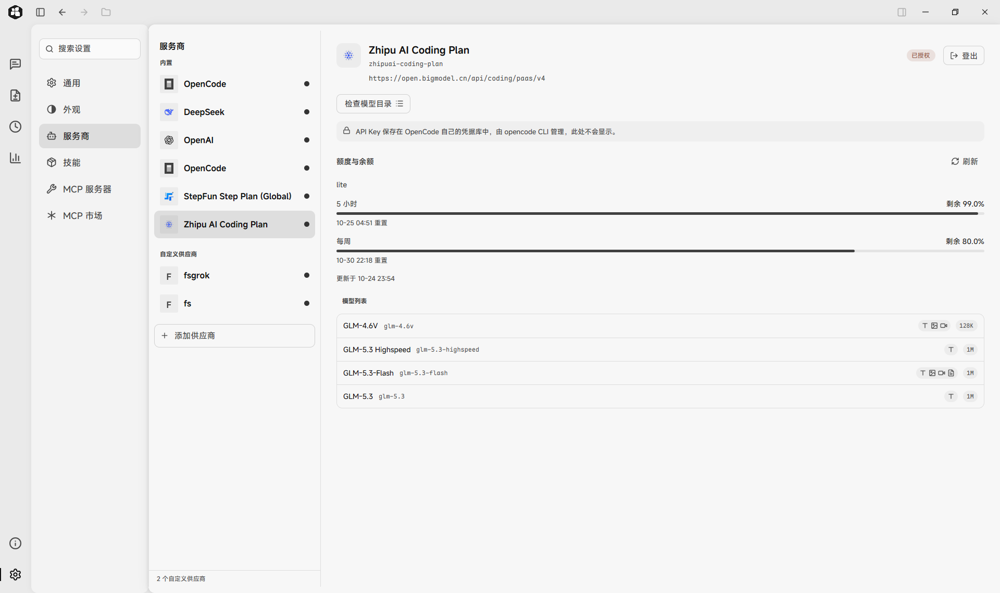

# Fintwind

Fintwind is a native Windows desktop client for OpenCode, built in Rust with
GPUI and Ely components. It brings coding conversations, project files, Git
review, a terminal and an optional browser into one workspace.

It is made for developers who work across projects and coding sessions.
Projects group conversations in the sidebar, while tabs keep several sessions
open. Replies, reasoning, tool calls and subagent activity appear in the
conversation. Markdown, Mermaid diagrams and mathematical formulas render
inside the native interface.

The context inspector separates reported occupancy from estimated composition.
Its treemap groups system instructions, tool definitions, conversation,
reasoning, tool calls, file content, other tool results and compaction
summaries. Opaque content is marked as unmeasurable rather than counted as
plain text.

## Review changes

Browse changed files, compare code side by side or in a unified diff, stage
changes and commit without leaving the workspace. The file browser and Git
history sit alongside the conversation when needed.

## Understand usage

Explore activity heatmaps, daily usage charts and model rankings from local
OpenCode history, including subagent usage. Token totals and cache hit rates
help compare sessions; displayed costs are estimates rather than bills.

## Manage providers

Choose models and reasoning settings, connect providers, inspect available
models and view supported subscription quotas. Provider credentials remain
managed by OpenCode. Fintwind starts its own local OpenCode service; inference
requests go to the model providers configured there.

Fintwind is released for Windows and is open source under GPL-3.0-only.
See the [website](https://fintwind.xyz/) or the
[source repository](https://github.com/roketskiy/fintwind).
