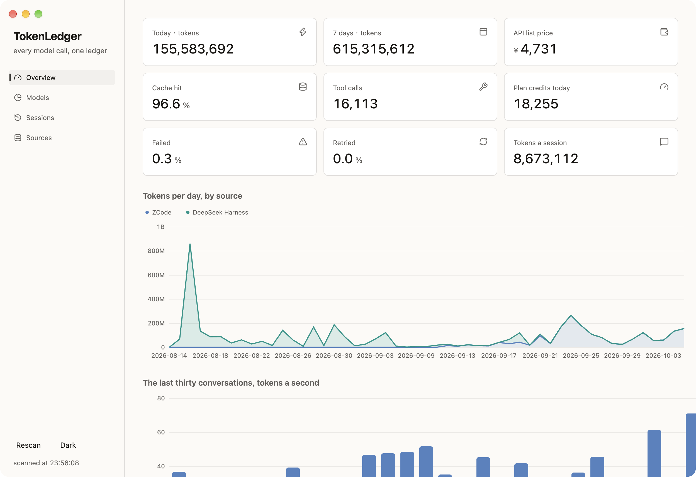
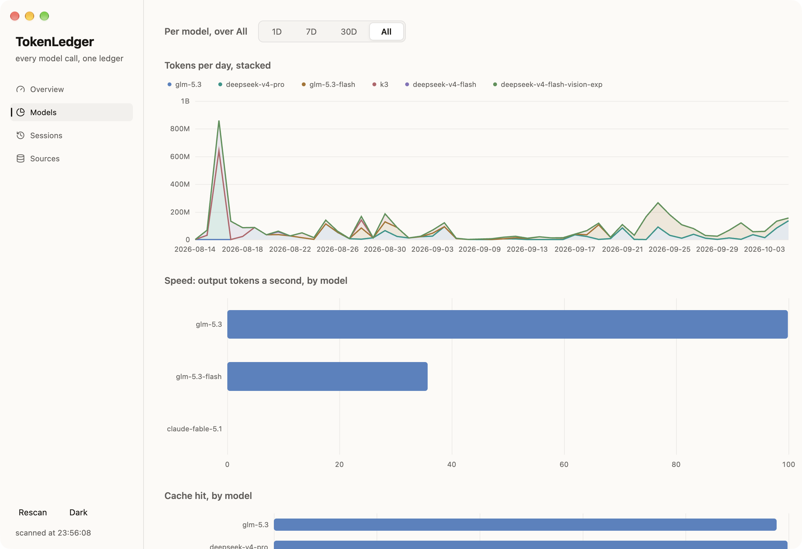
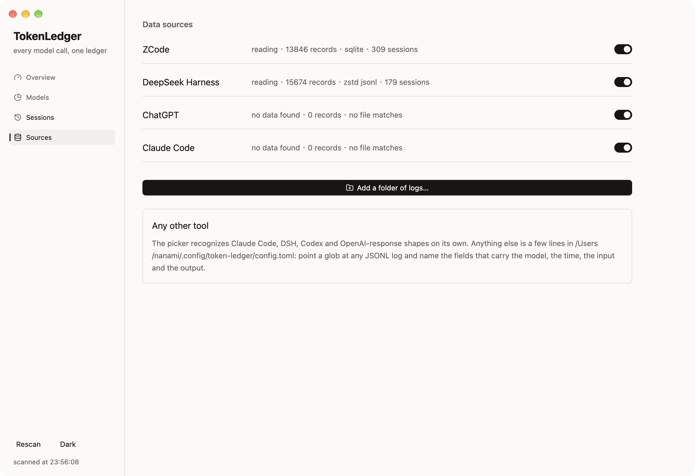

TokenLedger is a native macOS dashboard that answers one question for
everyone who builds with AI coding tools: what did the models actually
cost me today?

Every CLI assistant keeps its own usage log, in its own format, under
its own directory. TokenLedger reads them all on launch — ZCode's
SQLite ledger, Codex JSONL sessions, DeepSeek Harness workdirs, Claude
Code transcripts — and merges them into a single ledger of tokens,
requests, cache behavior and list-price cost. Any other folder that
matches a known log shape can be added from the Sources page, and any
source can be toggled off without touching a config file.

The Overview page carries a nine-tile KPI grid — today's tokens, the
trailing week, list-price cost, cache hit, tool calls, failed and
retried shares — over stacked area charts by source, a year of calendar
heat, the last two weeks hour by hour, and where the tokens go. The
Models page breaks the same ledger down per model over 1D, 7D, 30D or
all time: speed in output tokens a second, cache hit, and what the
usage would cost at each model's official card, never a guess for a
model without one.

It is built on Ely: the KPI tiles, the segmented span control, the data
table on the Models page, and every chart — areas, bars, lines, both
heatmaps — are Ely components in dark and light.

